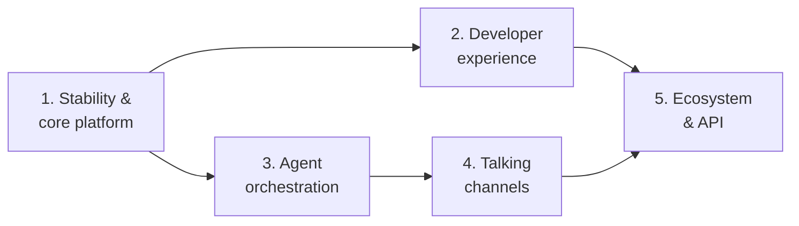
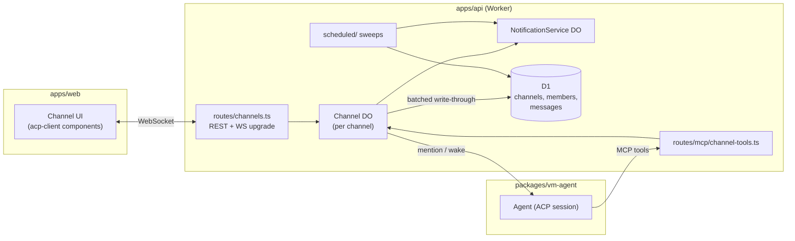

# SAM roadmap

This roadmap describes where Simple Agent Manager (SAM) goes next, in five phases. Each phase builds on the current architecture rather than replacing it:

- **Edge control plane** — `apps/api`, a Hono app on a Cloudflare Worker. D1 holds cross-project data (users, projects, tasks, dashboards); per-scope Durable Objects in `apps/api/src/durable-objects/` hold write-heavy state (`ProjectData`, `NodeLifecycle`, `TaskRunner`, `NotificationService`, `ProjectOrchestrator`, and others). Cron jobs live in `apps/api/src/scheduled/`.
- **Compute layer** — `packages/vm-agent`, the Go agent on each node (PTY, WebSocket, ACP gateway, MCP tool endpoints), plus Instant sessions on Cloudflare Containers.
- **Web app** — `apps/web`, the React + Vite control plane UI, using `packages/acp-client` and `packages/ui`.
- **Docs and website** — `apps/www`, Astro + Starlight.

What has already shipped is listed on the docs site under [Shipped Features](../apps/www/src/content/docs/docs/reference/roadmap.md). Detailed work items live in `tasks/backlog/`, and larger features get a spec in `specs/` before implementation.

Phases are ordered by dependency, not by calendar. Phase 1 runs continuously; phases 2 and 3 can overlap; phase 4 depends on the orchestration primitives from phase 3; phase 5 opens what the earlier phases built to outside tools.

## Phase 1: Stability and core platform

Goal: every task, session, workspace, and node reports a state the user can trust, and recovers or cleans up without manual intervention.

**Lifecycle accuracy**

- Converge task, chat session, and workspace status on one state machine so the UI, `TaskRunner`, and `ProjectData` agree (backlog: unified session/task/workspace state machine, trustworthy task status, lifecycle state accuracy, duplicate task/session finalization).
- Close the remaining gaps where sleeping, archived, or reaped work renders as unknown or keeps requesting deleted workspaces.

**Durable Object health**

- Isolate row-level faults in `ProjectData` so one bad record cannot take a project offline; finish archive sharding and storage relief.
- Investigate alarm wall time and the production DO cost spike; remove repeated no-op storage alarms.
- Simplify DO classes and schemas where several now overlap.

**Compute reliability**

- `packages/vm-agent`: in-place binary update, an explicit bootstrap pipeline, idempotent shutdown, and a hardened process lifecycle.
- Durable background VM provisioning, error-node cleanup, and capacity controls for Instant sessions.
- Keep the defense-in-depth model for orphans (DO alarm, cron sweep, max lifetime) and cover each layer with tests.

**Security and quality gates**

- Finish the open hardening items: port exposure, raw file access, deploy scripts, credential routes, and structured-log redaction.
- Fix flaky tests at the root, replace source-contract tests with behavioral tests, and repair failing Playwright audits on `main`.

**Exit criteria:** no known lifecycle state that the UI cannot name; stuck-task and orphan sweeps report zero repairs on a normal week; `pnpm check:fast` and the Playwright audits pass on `main` without retries.

## Phase 2: Developer experience

Goal: getting from "I have a repo" to "an agent is working on it" is fast, local-friendly, and well documented.

**Faster first prompt**

- Shorten agent session startup (devcontainer and agent install caching, warm node reuse).
- Persistent terminal sessions and a VM log browser in `apps/web`.
- Frontend performance: persisted query cache, lazy-loaded routes with error boundaries, and cached chat transcripts for instant chat switching.

**Local and self-hosted**

- Native local SAM desktop (spec `036-local-desktop`): the control plane, data, agents, and workspaces running on the user's machine, with local or cloud inference.
- Simpler self-hosting: split the `Env` interface, simplify deploy scripts and infrastructure, and support several installations in one Cloudflare account.
- Keep [local development](../apps/www/src/content/docs/docs/guides/local-development.md) and [self-hosting](../apps/www/src/content/docs/docs/guides/self-hosting.mdx) guides in step with each change.

**Everyday tooling**

- Grow `packages/cli` toward parity with the web app for project workflows.
- Devcontainer configs in secondary paths, better git identity handling, and clearer credential warnings.
- User-facing controls for assigning maintainer and viewer roles to project members.

**Exit criteria:** a new self-hoster can deploy by following the docs alone; a returning user's chat list and last chat paint without a network round trip; the CLI covers the project workflows in the [CLI reference](../apps/www/src/content/docs/docs/reference/cli-project-workflows.md).

## Phase 3: Agent orchestration

Goal: agents coordinate on multi-step work through durable, observable primitives, and humans can follow and steer that work.

SAM already has missions, `dispatch_task`, task dependencies, durable workflow runs (`start_workflow_run`), project event channels, and the durable mailbox (`send_durable_message`). This phase makes them reliable by default and easier to see.

- **Durable delivery by default** — durable follow-up prompt delivery and agent-to-agent `agent-dm.*` channels (`AGENT_MESSAGE_CHANNELS_ENABLED`) on by default, once the canonical project event wake path is proven on staging.
- **Graph execution** — evolve workflow runs toward the graph execution model: fan-out/fan-in, retries per step, and wait steps on any project event.
- **Smarter scheduling** — LLM-assisted task prioritization and placement hints that respect project → user → installation capacity pools.
- **Agent harness** — `packages/harness` phase 1 (a capable coding agent) and phase 2 (SAM platform integration), plus alternative inference providers.
- **Observability** — subagent idle detection, cancel and status events from `ProjectOrchestrator`, and a workflow view that goes beyond read-only (pause, retry a step, cancel).

**Exit criteria:** a three-step workflow survives a Worker deploy and a VM restart mid-run; every agent-to-agent message is either delivered or visibly dead-lettered.

## Phase 4: Talking channels

Goal: a Slack-like space where humans and agents talk in real time, in the open, inside a project.

Today conversation is one human with one agent (project chat), comments attached to a message or file, or agent-to-agent traffic the user rarely sees (mailbox, `agent-dm.*` channels, project event channels). Talking channels add a shared, persistent conversation that several people and several agents can read and write.

### Concepts

| Concept     | Description                                                                                                                                                                |
| ----------- | -------------------------------------------------------------------------------------------------------------------------------------------------------------------------- |
| **Channel** | A named conversation inside a project. Every project gets a default `#general`. A channel can also be bound to a workspace and is archived when that workspace is deleted. |
| **Member**  | A project member (human) or an agent participant (an agent profile, or a running task/session). Humans join by permission; agents join when invited or mentioned.          |
| **Message** | Markdown text with optional attachments and structured blocks (for example a plan or a PR link). Has a per-channel sequence number.                                        |
| **Thread**  | Replies to one message, kept out of the main timeline.                                                                                                                     |
| **Mention** | `@person` notifies a member; `@agent-profile` wakes or starts an agent.                                                                                                    |

Access follows project roles: viewers read, members and admins post, owners and admins manage channels.

### Architecture

**Channel Durable Object** (`apps/api/src/durable-objects/channel/`, binding `CHANNEL`, `env.CHANNEL.idFromName(channelId)`)

- One instance per channel. It is the single writer: it assigns message sequence numbers, so ordering is consistent for every reader.
- Hibernatable WebSockets fan out new messages, edits, reactions, typing, and presence to connected browsers, the same pattern `NotificationService` and `ProjectData` use.
- Embedded SQLite keeps a bounded window of recent messages so reconnecting clients catch up from their last sequence number without touching D1.
- New messages are written through to D1 in batches (debounced, like `scheduleSummarySync()`), with idempotent upserts keyed by `(channel_id, seq)` so a retried batch cannot duplicate rows.
- Added to the **top-level** `wrangler.toml` only, with a new append-only migration tag (see the Wrangler binding rule in `CLAUDE.md`).

**D1 persistence** (`apps/api/src/db/schema.ts` + a migration in `apps/api/src/db/migrations/`)

- `channels` — id, project, optional workspace, name, topic, archived state.
- `channel_members` — member kind (user or agent), role, last-read sequence number, notification preference.
- `channel_messages` — full history for paging, search, and cross-channel unread counts.

D1 is the durable record and answers cross-channel queries ("all my unread mentions"); the DO is the real-time path. Retention is configurable and enforced by a scheduled sweep.

**API** (`apps/api/src/routes/channels.ts`)

- REST: list, create, rename, and archive channels; manage members; page history; mark read.
- `GET /api/projects/:projectId/channels/:channelId/ws` upgrades to the Channel DO after `requireProjectCapability()` checks.
- Each posted message is also published as a project event, so existing event subscriptions and workflow wait steps can react to channel activity.

### Agent participation

Agents take part through the same two surfaces they already use.

- **MCP tools** (`apps/api/src/routes/mcp/channel-tools.ts`): `list_talk_channels`, `read_channel_messages`, `post_channel_message`, `reply_in_thread`, and `join_channel` / `leave_channel`. Names avoid clashing with the existing `list_event_channels` and `publish_channel_event` tools. Calls are rate-limited per agent with the existing `McpRateCounter`, and channel guidance is added to the `get_instructions` payload.
- **Waking agents**: when a message mentions an agent that has a live session, the Channel DO delivers it as a prompt through durable prompt delivery, and the `packages/vm-agent` ACP gateway hands it to the running agent. If no session is live, the mention can start one with `dispatch_task` using the mentioned agent profile, linked back to the thread.
- **`packages/acp-client`**: the channel UI renders agent posts with the same components as agent chat (`MessageBubble`, `ToolCallCard`, `PlanView`, Markdown and Mermaid rendering), and `MentionPalette` is extended from agent profiles to members and channels. A small channel transport hook sits next to `useAcpSession` so agent messages behave the same in chat and channels.
- **Relation to existing messaging**: the mailbox and `agent-dm.*` channels stay the private, machine-to-machine path. Whether `agent-dm.*` traffic should become visible as direct-message channels is an open question for the spec.

### Channel UI (`apps/web`)

- A **Channels** entry in project navigation with a channel list, unread and mention badges, and a `ProjectChannels` page.
- Timeline with day separators, threads in a side panel (bottom sheet on mobile), reactions, edit and delete for your own messages, and agent posts marked clearly as agents.
- Composer with `@` mentions for members, agent profiles, and channels; file attachments through the existing project file storage.
- Mobile-first layout, keyboard navigation, and screen-reader announcements for new messages, following `packages/ui` tokens and the UI rules.

### Notifications

- New notification types in `NotificationService`: `channel_mention` (medium urgency, Web Push) and `channel_message` (low, opt-in per channel). They follow existing per-project preferences, batching, and deduplication.
- **Scheduled jobs** (`apps/api/src/scheduled/`, registered in `handler.ts`): an hourly unread digest for members with unread mentions older than a configurable threshold, run on the existing hourly maintenance cron; a daily retention sweep for `channel_messages`; and a sweep that removes agent memberships whose task or session has ended.

### Configuration

All limits are environment variables with defaults in `packages/shared` (no hardcoded values): `CHANNELS_ENABLED` (default `false`), maximum message length, history page size, DO recent-message window, D1 write-through batch delay, digest threshold, and retention days.

### Milestones

1. **4a — Spec and foundations**: a spec in `specs/`, D1 tables, Channel DO with WebSocket fan-out, REST routes, behind `CHANNELS_ENABLED`.
2. **4b — Human channels**: channel UI in `apps/web`, threads, mentions between members, `channel_mention` notifications.
3. **4c — Agents in channels**: MCP channel tools, mention-to-wake and mention-to-dispatch, acp-client rendering of agent posts.
4. **4d — Polish**: digests and retention sweeps, search, workspace-bound channels, and a docs guide in `apps/www`.

**Exit criteria:** on staging, two humans and two agents hold a threaded conversation in one channel; messages arrive in order on every client within a second; a disconnected client catches up without gaps; an `@agent` mention reaches a running agent and gets a reply in the thread.

### Open questions

- Should the DO keep full history in SQLite and use D1 only for indexes, if D1 write volume becomes a cost concern?
- How should agents' own posts be budgeted so two agents cannot loop on each other?
- Should `agent-dm.*` channels and the mailbox move onto Channel DOs once channels are stable?

## Phase 5: Ecosystem and API

Goal: other tools can build on SAM, and SAM fits into the tools teams already use.

- **Public, versioned API** — stable `/v1` routes generated from the OpenAPI spec in `apps/api/openapi`, authenticated with API tokens, with the [API reference](../apps/www/src/content/docs/docs/reference/api.md) generated from the spec.
- **Outbound webhooks** — signed webhooks for task, workflow, deployment, and channel events, built on project event subscriptions.
- **SAM Connector** — extend the [SAM Connector](../apps/www/src/content/docs/docs/guides/sam-connector.md) to read and post in talking channels.
- **Chat bridges** — optional Slack and Microsoft Teams bridges that mirror a SAM channel, so people can talk to agents from where they already are.
- **Providers and repositories** — AWS and further cloud providers through `packages/providers`; GitLab parity with GitHub.
- **Billing integration** — usage-based billing on top of the existing compute and AI usage records.
- **Extensibility** — shareable agent profiles, skills, and MCP server configurations across projects and installations.

**Exit criteria:** a third-party script can create a project task, follow it to completion, and receive a signed webhook, using only the public API and its docs.

## Keeping this roadmap current

- When an item ships, move it to [Shipped Features](../apps/www/src/content/docs/docs/reference/roadmap.md) and remove it here.
- Keep this file and the docs-site page (`apps/www/src/content/docs/docs/roadmap.mdx`) in sync.
- Larger items get a spec in `specs/` and task files in `tasks/backlog/` before implementation starts.
